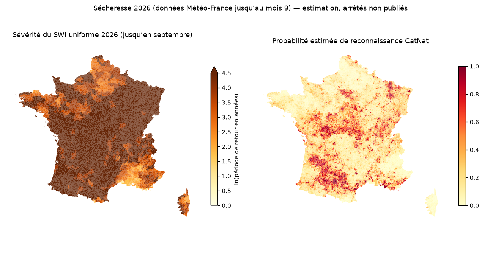
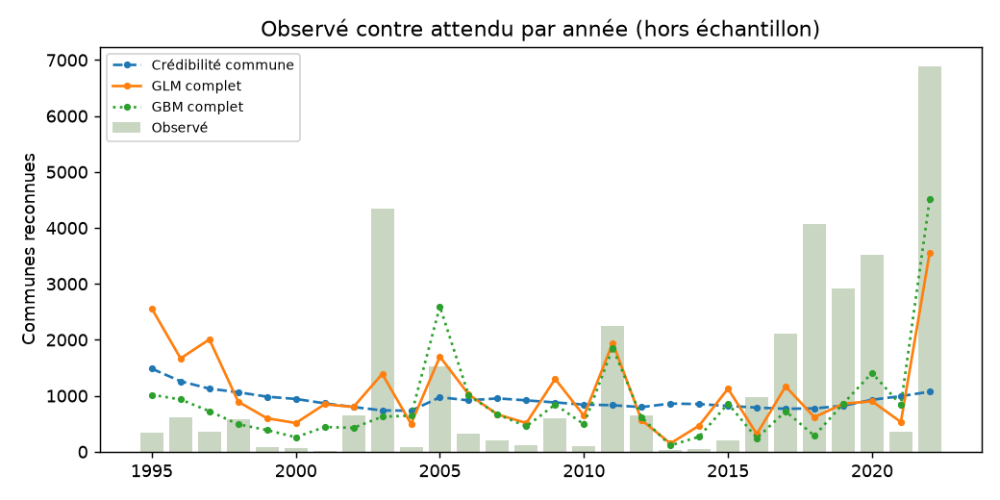

# Sécheresse CatNat : SWI uniforme, fréquence de reconnaissance et intervalles d'incertitude

Projet actuariel sur le péril sécheresse (retrait-gonflement des argiles) du régime CatNat. Il s'appuie sur le **SWI uniforme** de Météo-France, l'indicateur du critère météorologique CatNat, et sur les arrêtés de reconnaissance par commune. Il répond à trois questions :

1. **Prévoir le SWI uniforme** d'été (prévision fin mai) et l'interpoler dans l'espace (variogramme, krigeage).
2. **Estimer la fréquence de reconnaissance** d'une commune pour une année donnée, avec un modèle validé hors échantillon.
3. **Donner un résultat avec intervalle** : probabilité par commune et nombre de communes reconnues, avec leurs intervalles.

Le projet d'origine (notebooks archivés dans [`archive/notebooks/`](archive/notebooks/), score composite sur le Drive de l'équipe) est audité dans [AUDIT.md](AUDIT.md).

## Résultat : sécheresse 2026 (arrêtés non encore publiés)

Données SWI uniforme de janvier à septembre 2026. Détail : [reports/ete_2026.json](reports/ete_2026.json), communes : [reports/ete_2026_communes.csv](reports/ete_2026_communes.csv) (probabilité et intervalle à 90 % par commune).

| | Valeur |
|---|---:|
| Sévérité (plus grande période de retour du SWI uniforme trimestriel) | la plus élevée des 35 années comparées |
| **Nombre attendu de communes reconnues** (modèle) | **≈ 8 200** |
| Intervalle à 90 % de l'estimation (incertitude des paramètres, bootstrap par années) | 5 700 – 10 400 |
| Intervalle de prédiction à 80 % (erreur de niveau annuel du backtest) | 1 000 – 19 800 |
| Intervalle de prédiction à 90 % | 800 – 24 300 |
| Couverture réelle de ces intervalles, une année laissée de côté (28 années) | 79 % (nominal 80 %) ; 82 % (nominal 90 %) |

**Deux intervalles, deux sens.** Le premier mesure l'incertitude *statistique* du modèle ; il est étroit. Le second mesure ce qui compte vraiment : l'écart entre le nombre prédit et le nombre reconnu une année donnée, très large car le niveau annuel de reconnaissance n'est pas stationnaire. Sur les 28 années du backtest, le rapport observé/attendu a une médiane de 0,42 (déciles 0,12 et 2,4) ; de 2016 à 2022 il vaut 0,7 à 6,6 (médiane 3,1). **Le centre de l'intervalle de prédiction n'est donc pas fiable** : selon le régime retenu, la valeur centrale va d'environ 3 500 à bien plus de 8 200. L'ordre de grandeur annoncé est une enveloppe, pas une prévision ponctuelle. De plus, 2026 est plus sévère que toute année d'apprentissage : le modèle extrapole.

Régions les plus exposées (part attendue des communes) : Île-de-France 34 %, Centre-Val de Loire 34 %, Nouvelle-Aquitaine 33 %, Occitanie 33 %.



## 1. SWI uniforme : prévision et géostatistique

Le SWI uniforme est celui du modèle SIM configuré avec un sol argileux et un couvert gazonné identiques sur tout le territoire (documentation Météo-France, `data/raw/swi_presentation.pdf`). Le fichier de suivi (1958–2026) et le fichier de référence CatNat (1960–2025) sont identiques sur leur recouvrement (vérifié).

**Prévision du SWI d'été (JJA) fin mai**, validation par origine glissante, test 1985–2026 :

| Modèle | RMSE | Corrélation | RMSE, années sèches |
|---|---:|---:|---:|
| Persistance (SWI d'été précédent) | 0,189 | 0,51 | 0,219 |
| Climatologie de la maille | 0,151 | 0,68 | 0,200 |
| **Ridge** | **0,123** | **0,77** | **0,114** |
| Forêt aléatoire | 0,135 | 0,72 | 0,132 |
| Gradient boosting | 0,147 | 0,68 | 0,144 |

Le modèle linéaire (ridge) bat les modèles non linéaires : il extrapole mieux la tendance climatique. Il prévoit un état hydrique, pas la météo de l'été, d'où la corrélation modeste au niveau national (0,50).

**Géostatistique** (SWI d'été 2022, 8 981 mailles) : indice de Moran I = 0,87 (p = 0,005 par permutations) ; variogramme sphérique de portée ≈ 237 km ; krigeage ordinaire validé par blocs spatiaux retirés : RMSE 0,039 (blocs de 100 km) pour un écart-type du champ de 0,085, couverture 97 % de l'intervalle à 95 %. Détail : [reports/swi_study.json](reports/swi_study.json).

**Critère météorologique reconstitué** (fenêtres glissantes de 3 mois, période de retour par maille sur les années antérieures) contre les arrêtés 1989–2022 :

| Période de retour | Sensibilité | Précision |
|---|---:|---:|
| 10 ans | 80 % | 5 % |
| 25 ans | 67 % | 7 % |
| 50 ans | 57 % | 9 % |

Le critère est nécessaire mais pas suffisant : la reconnaissance exige aussi un critère géotechnique (argile) et une demande. Les paramètres exacts de la circulaire ne sont pas publiés dans les données ; cette reconstitution est paramétrable et évaluée, pas officielle. Sa période de retour maximale entre comme variable (`rp_max_log`) dans le modèle de fréquence.

## 2. Modèle de fréquence de reconnaissance

Variable à expliquer : la commune a au moins un arrêté sécheresse pour un événement débutant l'année t (34 746 communes, 1989–2022). Validation « en temps réel » : apprentissage sur les années ≤ t − 2 (retard de publication des arrêtés), test sur l'année t entière, 1995–2022. Aucun découpage aléatoire.

| Modèle | Gain de log-loss vs constante, 1995–2022 | Idem 2010–2022 | AUC 1995–2022 |
|---|---:|---:|---:|
| Fréquence communale crédibilisée | 5,6 % | 3,7 % | 0,702 |
| GLM, SWI uniforme seul | 12,0 % | 13,9 % | 0,775 |
| GLM, SWI uniforme + exposition RGA | 20,7 % | 20,7 % | 0,852 |
| **GLM complet** (+ historique publié) | **21,3 %** | **23,7 %** | **0,861** |
| Gradient boosting | 18,0 % | 18,4 % | 0,837 |

Les indicateurs sont calculés sans information future (climatologie expansive) ; l'historique de reconnaissance ne compte que les arrêtés publiés avant le 1er janvier de l'année prédite. Passer du SWI à sols réels au SWI uniforme ne change presque pas le pouvoir prédictif (21,2 % avant, 21,3 % après) mais aligne le modèle sur l'indicateur du dispositif.



La **classification** des communes est bonne (AUC de 0,69 à 0,96 selon l'année), le **niveau annuel** est le point faible (voir ci-dessus). Cartes France, départements et région : [reports/RESULTATS.md](reports/RESULTATS.md).


## 3. Vérification de l'ancien score « CatNat-like » (Bouches-du-Rhône)

Les bases du Drive de l'équipe contiennent, pour les 119 communes du 13, un score composite (aléa argile BRGM normalisé × part de jours secs), et pour la Nouvelle-Aquitaine un score départemental. Contre la fréquence réelle de reconnaissance 1989–2022 des communes du 13 ([reports/old_score_check.json](reports/old_score_check.json)) :

| Indicateur | Corrélation de rang (Spearman) | Intervalle à 90 % (bootstrap) |
|---|---:|---:|
| Score composite d'origine | 0,28 | 0,13 – 0,42 |
| Aléa argile BRGM seul | **0,59** | 0,48 – 0,68 |
| Part de jours secs seule | −0,21 | −0,35 – −0,07 |
| Modèle de fréquence (probabilité moyenne) | 0,49 | 0,35 – 0,63 |

Le score composite est dégradé par sa composante « jours secs », anticorrélée avec la reconnaissance dans ce département (la sécheresse est quasi homogène dans le 13, ce sont les différences d'argile qui discriminent). L'aléa argile communal est le meilleur prédicteur du 13 : il surpasse notre exposition RGA, qui n'est disponible qu'à l'échelle de l'EPCI. Intégrer l'aléa BRGM communal à toute la France est la principale amélioration identifiée.

## Données et reproductibilité

Sources publiques : Météo-France (SWI uniforme suivi et référence CatNat, SIM mensuelle, points de grille), GASPAR (arrêtés), SDES (exposition RGA), geo.api.gouv.fr, Etalab (contours). `python -m pipeline.download` les télécharge (≈ 400 Mo, `data/raw/`, non versionné) avec empreintes SHA-256 dans [`data/manifest.json`](data/manifest.json). Les 22 fichiers du Drive de l'équipe sont dans `data/drive/` (non versionné) ; leur manifeste est [`data/drive_manifest.json`](data/drive_manifest.json). Catalogue : [data_catalog.md](data_catalog.md).

```sh
python -m venv .venv && .venv/bin/pip install -r requirements.txt   # Windows : .venv\Scripts\
python -m pipeline.download      # sources publiques
python -m pipeline.run           # table, validation 1995–2022, cartes (≈ 30 min)
python -m pipeline.swi_study     # prévision du SWI, géostatistique, critère
python -m pipeline.nowcast       # estimation de l'année en cours avec intervalles
python -m pipeline.old_score_check   # ancien score contre arrêtés (nécessite data/drive/)
python -m pytest tests -q        # tests unitaires (+ contrôles sur données réelles si présentes)
```

## Limites

- **Fréquence, pas charge** : aucune donnée publique de sinistres ou de coûts à la commune. Pas de prime pure.
- **Niveau annuel non stationnaire** : la procédure de reconnaissance et ses critères ont évolué ; c'est la première source d'incertitude (intervalle de prédiction très large).
- Exposition RGA par EPCI, population et contours : photographies récentes appliquées à toutes les années ; l'aléa argile communal BRGM n'est disponible ici que pour le 13 et, à l'échelle départementale, la Nouvelle-Aquitaine.
- Le critère météorologique est une reconstitution, pas le critère officiel.
- 2026 : données provisoires (jusqu'en septembre), sévérité hors de la plage d'apprentissage.
- La note LaTeX n'est pas encore rédigée ; son générateur de tableaux (`pipeline/make_tables.py`) n'est pas finalisé.

## Organisation

`catnat/` (données, SWI uniforme, critère, prévision, géostatistique, variables, modèles, incertitude, cartes), `pipeline/` (exécutions), `tests/` (tests unitaires et contrôles sur données réelles), `reports/` (résultats mesurés, figures), `archive/notebooks/` (version d'origine).
