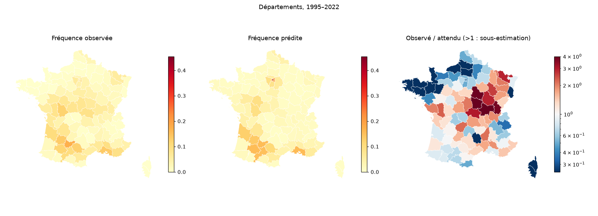

# Sécheresse CatNat : fréquence annuelle de reconnaissance par commune

Modèle de **fréquence** du péril sécheresse (retrait-gonflement des argiles) au sens du régime CatNat. Pour chaque commune de France métropolitaine et chaque année, il estime la probabilité qu'un arrêté de reconnaissance porte sur un événement débutant cette année-là, à partir de l'humidité des sols Météo-France et de l'exposition aux argiles. Il est appliqué à la **sécheresse de 2026**, dont les arrêtés ne sont pas encore publiés.

Le projet d'origine (notebooks archivés dans [`archive/notebooks/`](archive/notebooks/)) prédisait le SWI lui-même, avec le SWI de la veille comme variable et des découpages aléatoires ; ses défauts sont décrits dans [AUDIT.md](AUDIT.md). Cette version repart des sources publiques et pose la question actuarielle : **quelle est la fréquence de reconnaissance, et le modèle est-il calibré en nombre de communes touchées par an ?**

## Sécheresse 2026 : estimation

Données Météo-France de janvier à octobre 2026 ; arrêtés pas encore publiés. Détail : [reports/ete_2026.json](reports/ete_2026.json).

- **Sécheresse des sols la plus sévère de la série** : SSWI3 de septembre moyen de −2,33 sur les communes, contre −1,59 en 2022 et −1,27 en 2003 (1er sur 35 années comparées, 1989–2022 et 2026).
- **Nombre attendu de communes reconnues : environ 9 900**, contre 6 894 en 2022, record de la période.
- **Incertitude très large.** Dans le backtest du même modèle, l'observé a valu de 0,11 à 2,6 fois l'attendu selon les années (déciles 10 % et 90 %), soit une fourchette empirique d'environ 1 100 à 25 700 communes. La sévérité de 2026 dépasse aussi tout ce qui a été observé pendant l'apprentissage : le modèle extrapole.
- **Régions les plus exposées** (part attendue des communes) : Centre-Val de Loire (44 %), Île-de-France (44 %), Nouvelle-Aquitaine (40 %), Occitanie (39 %), Bourgogne-Franche-Comté (37 %). En nombre de communes, Occitanie (≈ 1 750) et Nouvelle-Aquitaine (≈ 1 700) dominent.


Cartes départementale et régionale (Centre-Val de Loire) : [départements](reports/figures/ete_2026_departements.png), [région](reports/figures/ete_2026_region.png).

## Données (publiques, téléchargées et vérifiées par empreinte)

| Source | Usage |
|---|---|
| Météo-France, SIM2 mensuelle Safran-Isba 1959–2025 (maille ≈ 8 km) | SWI, SSWI3, SSWI12 |
| Météo-France, points de grille `SHP_SIM_FRANCE` | Rattachement commune → maille (centre de commune, distance médiane 3 km, max 12,7 km) |
| data.gouv.fr, arrêtés CatNat par commune (GASPAR) | Variable à expliquer : périls « Sécheresse » et « Retrait-gonflement des argiles » |
| SDES, exposition RGA par EPCI | Part de surface en aléa moyen et fort |
| geo.api.gouv.fr, communes ; contours Etalab 2026 (100 m) | Centre, population, surface, EPCI ; cartes |

`python -m pipeline.download` télécharge ≈ 320 Mo dans `data/raw/` (non versionné) et contrôle les empreintes de [`data/manifest.json`](data/manifest.json). Détail : [data_catalog.md](data_catalog.md).

## Méthode

- **Variable à expliquer.** `y = 1` si la commune a au moins un arrêté sécheresse pour un événement débutant l'année t. Grille complète commune × année : 34 746 communes, 1989–2022, 1 181 364 lignes, fréquence moyenne 3,5 %.
- **Censure à droite.** Un arrêté est publié de quelques mois à plusieurs années après la fin de l'événement (médiane de 0,5 à 4 ans selon l'année, jusqu'à 9 ans). La dernière année retenue est calculée : 2022 est mûre à la date de coupure du fichier (9 juillet 2025), 2023 ne l'est pas ([figure](reports/figures/retard_publication.png)).
- **Indicateurs météo sans information future.** Anomalies standardisées du SWI (été, automne, minimum mensuel, été précédent), calculées avec une climatologie **des seules années antérieures** depuis 1959 ; SSWI3 de septembre et SSWI12 de fin de période.
- **Exposition.** Parts de surface RGA moyen et fort de l'EPCI, population (log).
- **Historique connu.** Nombre d'années de reconnaissance sur les dix années précédentes, **en ne comptant que les arrêtés déjà publiés au 1er janvier de l'année prédite**.
- **Validation en temps réel.** Pour prédire l'année t, apprentissage sur les années ≤ t − 2 seulement (retard de publication). Années de test 1995–2022, aucun découpage aléatoire.
- **Modèles.** Fréquence constante ; fréquence par commune crédibilisée (Bühlmann simplifié, k = 3) ; régressions logistiques de plus en plus riches ; gradient boosting.
- **Année en cours.** Même modèle, réentraîné sur 1989–2022 avec des indicateurs arrêtés au dernier mois disponible (octobre), pour toutes les années.

## Résultats mesurés (hors échantillon)

| Modèle | Gain de log-loss vs constante, 1995–2022 | Idem, 2010–2022 | AUC 1995–2022 | Communes attendues / observées, 1995–2022 |
|---|---:|---:|---:|---:|
| Fréquence constante | 0 % | 0 % | 0,448 | 25 790 / 34 001 |
| Fréquence commune crédibilisée | 5,6 % | 3,7 % | 0,702 | 25 790 / 34 001 |
| GLM météo | 13,1 % | 15,4 % | 0,782 | 27 820 / 34 001 |
| GLM météo + exposition | 20,7 % | 20,9 % | 0,847 | 27 428 / 34 001 |
| **GLM complet** (+ historique publié) | **21,2 %** | **23,9 %** | 0,855 | 31 350 / 34 001 |
| GBM complet | 21,3 % | 21,2 % | 0,858 | 25 460 / 34 001 |

Élargir la période d'apprentissage (1989 au lieu de 2006) améliore le modèle sur les mêmes années de test 2010–2022 : le gain du GLM complet passe de 18,8 % à 23,9 %.


**Lecture.**
- Le modèle **classe bien les communes** au sein d'une année : AUC de 0,73 (2018) à 0,96 selon l'année. L'humidité des sols apporte l'essentiel du gain, puis l'exposition aux argiles, puis l'historique.
- Le **niveau annuel** est le point faible. Le modèle surestime la plupart des années 1995–2015, peu reconnues (mais sous-estime 2003, ×4), et sous-estime 2016–2020 (observé/attendu de 1,9 à 7,8). En 2022 l'écart retombe à 1,4. Le niveau de reconnaissance n'est pas stationnaire, et la météo seule ne l'explique pas. Une charge de portefeuille exigerait donc un recalage annuel du niveau.
- La géographie des écarts est nette : le Centre-Est est fortement sous-estimé (Nièvre ×5,6, Saône-et-Loire ×4,5, Yonne ×3,9, Jura ×3,8).
- Les indicateurs météo sont corrélés entre eux : leurs coefficients s'interprètent conjointement, pas un par un.

### Cartes




Région détaillée : **Occitanie**, choisie car c'est la plus touchée sur 1995–2022 (6,3 % des communes-années reconnues). En 2022, 1 488 communes y ont été reconnues, pour 1 208 attendues.


Détail par année, par département, calibration par décile et coefficients : [reports/RESULTATS.md](reports/RESULTATS.md), [reports/results.json](reports/results.json), [reports/departements.csv](reports/departements.csv).

## Limites

- **Fréquence de reconnaissance, pas de charge** : aucune donnée publique de sinistres ou de coûts à la commune. Le modèle ne fournit ni prime pure ni coût moyen.
- La reconnaissance dépend aussi d'une procédure administrative (demande communale, critères modifiés au cours de la période) que les données météo ne décrivent pas : c'est la principale source d'écart de niveau annuel.
- Exposition RGA, population et contours sont des photographies récentes, appliquées à toutes les années ; 14 communes n'ont pas de donnée RGA (indicateur dédié).
- Chaque commune est rattachée à une seule maille (celle de son centre), sans pondération par la surface argileuse.
- 2026 : estimation sur des données provisoires (jusqu'à octobre), au-delà de la plage de sévérité observée.

## Utilisation

```sh
python -m venv .venv && .venv/bin/pip install -r requirements.txt   # Windows : .venv\Scripts\
python -m pipeline.download   # ≈ 320 Mo, une fois
python -m pipeline.run        # table, validation 1995–2022, cartes, reports/results.json (≈ 30 min)
python -m pipeline.report     # reports/RESULTATS.md
python -m pipeline.nowcast    # estimation de l'année en cours (télécharge le fichier SIM de l'année)
python -m pytest tests -q     # tests unitaires ; contrôles sur données réelles si data/raw existe
```

## Organisation

- `catnat/` : lecture des sources, variable à expliquer et maturité, indicateurs, modèles, mesures, cartes.
- `pipeline/` : téléchargement vérifié, validation complète, rapport, estimation de l'année en cours.
- `tests/` : tests unitaires sur données synthétiques (absence de fuite temporelle, historique publié, crédibilité, indicateurs en cours d'année, mesures, formats des sources) et contrôles sur données réelles.
- `reports/` : résultats mesurés et figures.
- `archive/notebooks/` : notebooks d'origine, conservés pour traçabilité, non utilisés.
