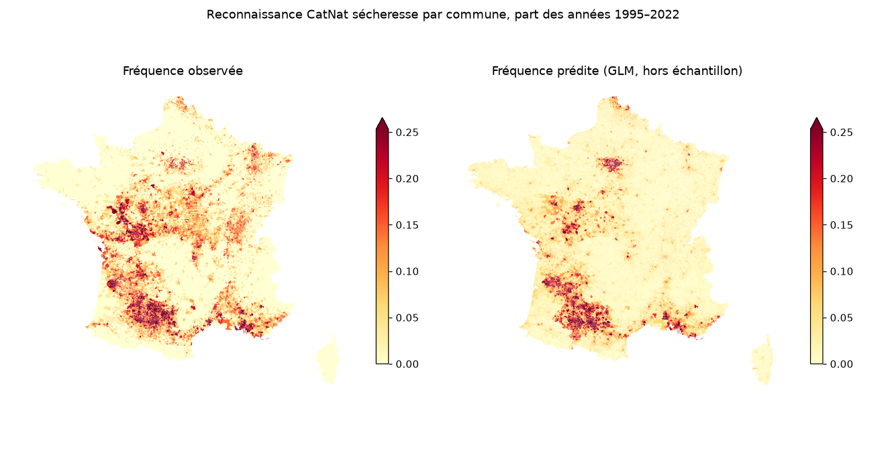
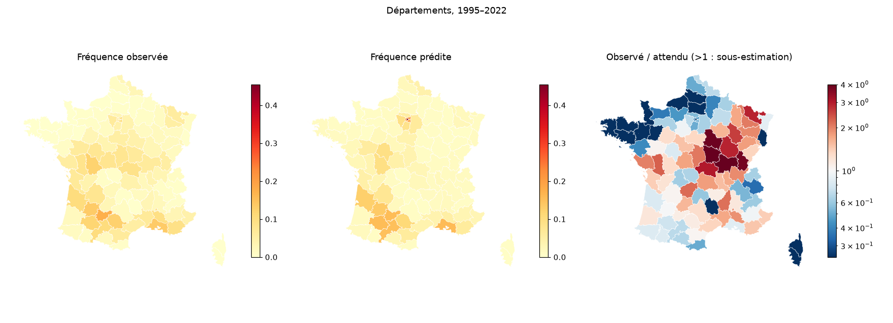
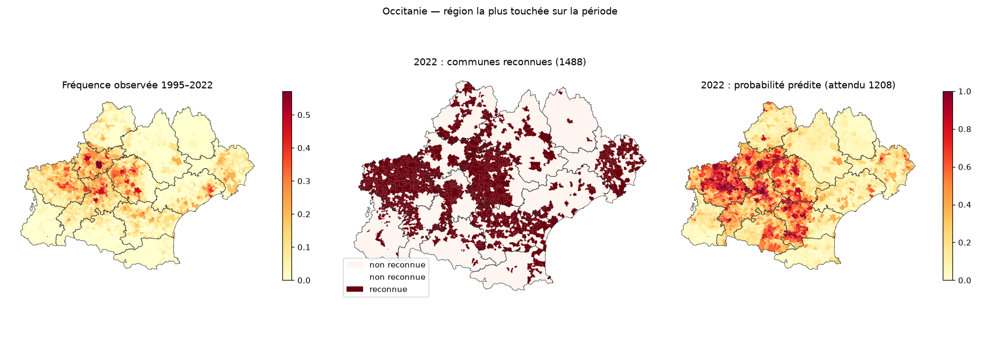

# Résultats mesurés — fréquence de reconnaissance CatNat sécheresse

Table : 34746 communes × années 1989–2022 (1181364 lignes), fréquence moyenne 3,52 %. Coupure des arrêtés : 2025-07-09 ; dernière année mûre : 2022.
Validation : origine glissante par année ; apprentissage sur années ≤ t−2 ; années de test 1995–2022.

## Scores agrégés hors échantillon

| Modèle | Log-loss | Gain vs constante | Brier | Gain Brier | AUC | Attendu | Observé |
|---|---:|---:|---:|---:|---:|---:|---:|
| Fréquence constante | 0,1542 | 0,0 % | 0,0339 | 0,0 % | 0,448 | 25 790 | 34001 |
| Fréquence commune crédibilisée | 0,1455 | 5,6 % | 0,0328 | 3,1 % | 0,702 | 25 790 | 34001 |
| GLM météo | 0,1340 | 13,1 % | 0,0323 | 4,7 % | 0,782 | 27 820 | 34001 |
| GLM météo + exposition | 0,1223 | 20,7 % | 0,0306 | 9,5 % | 0,847 | 27 428 | 34001 |
| GLM complet | 0,1215 | 21,2 % | 0,0309 | 8,6 % | 0,855 | 31 350 | 34001 |
| GBM complet | 0,1213 | 21,3 % | 0,0297 | 12,4 % | 0,858 | 25 460 | 34001 |

### Sous-période 2010–2022 (mêmes modèles, historique d’apprentissage plus long)

| Modèle | Log-loss | Gain vs constante | AUC | Attendu | Observé |
|---|---:|---:|---:|---:|---:|
| Fréquence constante | 0,2192 | 0,0 % | 0,552 | 11 149 | 24106 |
| Fréquence commune crédibilisée | 0,2110 | 3,7 % | 0,700 | 11 149 | 24106 |
| GLM météo | 0,1855 | 15,4 % | 0,802 | 14 222 | 24106 |
| GLM météo + exposition | 0,1734 | 20,9 % | 0,848 | 13 101 | 24106 |
| GLM complet | 0,1668 | 23,9 % | 0,857 | 14 578 | 24106 |
| GBM complet | 0,1727 | 21,2 % | 0,854 | 12 920 | 24106 |

## Cartes

Région détaillée : **Occitanie**, choisie car la plus touchée sur la période (fréquence observée 6,3 % des communes-années). Année détaillée : 2022, 1488 communes reconnues pour 1 208 attendues.

Départements les plus sous-estimés (observé/attendu) :

| Département | Observé | Attendu | Ratio |
|---|---:|---:|---:|
| 58 | 560 | 99 | 5,63 |
| 71 | 1003 | 224 | 4,48 |
| 89 | 511 | 132 | 3,88 |
| 39 | 752 | 201 | 3,75 |
| 03 | 781 | 257 | 3,04 |
| 21 | 557 | 192 | 2,90 |
| 57 | 1206 | 417 | 2,89 |
| 52 | 226 | 86 | 2,62 |

## Observé contre attendu par année

| Année | Observé | Crédibilité | GLM complet | GBM complet | Obs./att. GLM | AUC GLM |
|---|---:|---:|---:|---:|---:|---:|
| 1995 | 333 | 1 484 | 2 269 | 1 232 | 0,15 | 0,851 |
| 1996 | 614 | 1 259 | 1 467 | 1 065 | 0,42 | 0,847 |
| 1997 | 351 | 1 127 | 1 606 | 939 | 0,22 | 0,904 |
| 1998 | 578 | 1 063 | 965 | 681 | 0,60 | 0,927 |
| 1999 | 87 | 984 | 783 | 403 | 0,11 | 0,933 |
| 2000 | 71 | 943 | 677 | 288 | 0,10 | 0,919 |
| 2001 | 15 | 865 | 798 | 505 | 0,02 | 0,776 |
| 2002 | 653 | 799 | 880 | 464 | 0,74 | 0,928 |
| 2003 | 4352 | 739 | 1 093 | 1 141 | 3,98 | 0,784 |
| 2004 | 77 | 733 | 592 | 888 | 0,13 | 0,868 |
| 2005 | 1521 | 974 | 1 740 | 1 350 | 0,87 | 0,921 |
| 2006 | 323 | 918 | 862 | 793 | 0,37 | 0,901 |
| 2007 | 203 | 953 | 635 | 579 | 0,32 | 0,958 |
| 2008 | 121 | 918 | 734 | 484 | 0,16 | 0,919 |
| 2009 | 596 | 881 | 1 672 | 1 726 | 0,36 | 0,882 |
| 2010 | 100 | 843 | 720 | 628 | 0,14 | 0,914 |
| 2011 | 2247 | 831 | 1 660 | 1 394 | 1,35 | 0,908 |
| 2012 | 648 | 798 | 772 | 647 | 0,84 | 0,953 |
| 2013 | 23 | 861 | 216 | 107 | 0,11 | 0,945 |
| 2014 | 44 | 852 | 405 | 190 | 0,11 | 0,940 |
| 2015 | 205 | 819 | 1 086 | 695 | 0,19 | 0,937 |
| 2016 | 982 | 789 | 416 | 293 | 2,36 | 0,911 |
| 2017 | 2104 | 767 | 1 108 | 832 | 1,90 | 0,888 |
| 2018 | 4061 | 775 | 524 | 370 | 7,75 | 0,725 |
| 2019 | 2923 | 821 | 1 055 | 843 | 2,77 | 0,778 |
| 2020 | 3520 | 929 | 1 137 | 948 | 3,09 | 0,792 |
| 2021 | 355 | 993 | 530 | 788 | 0,67 | 0,867 |
| 2022 | 6894 | 1 072 | 4 948 | 5 184 | 1,39 | 0,794 |

## Coefficients du GLM complet (dernier apprentissage)

Variables standardisées ; rapport de cotes pour un écart-type. Les indicateurs météo sont corrélés : lecture conjointe.

| Variable | Coefficient | Rapport de cotes |
|---|---:|---:|
| `swi_jja_z` | 0,482 | 1,620 |
| `swi_son_z` | -0,272 | 0,762 |
| `swi_min_z` | -0,429 | 0,651 |
| `sswi3_sep` | -1,132 | 0,322 |
| `sswi12_dec` | -0,089 | 0,915 |
| `swi_jja_z_prev` | 0,092 | 1,096 |
| `rga_mid_share` | 0,301 | 1,352 |
| `rga_high_share` | 0,565 | 1,760 |
| `rga_missing` | -0,060 | 0,942 |
| `log_population` | 0,509 | 1,663 |
| `hist_count` | 0,248 | 1,281 |

## Retard de publication des arrêtés (années, fin d’événement → publication)

| Année d’événement | Arrêtés | Médiane | 90 % | 99 % | Max |
|---|---:|---:|---:|---:|---:|
| 2000 | 118 | 2,08 | 4,03 | 7,28 | 7,28 |
| 2001 | 24 | 2,07 | 5,04 | 5,95 | 5,95 |
| 2002 | 877 | 1,18 | 2,28 | 6,11 | 6,52 |
| 2003 | 4468 | 1,66 | 2,50 | 4,85 | 5,55 |
| 2004 | 287 | 4,20 | 4,95 | 6,95 | 7,38 |
| 2005 | 3233 | 2,55 | 3,18 | 3,80 | 6,38 |
| 2006 | 473 | 2,20 | 2,59 | 3,72 | 4,20 |
| 2007 | 459 | 1,35 | 1,55 | 2,95 | 3,20 |
| 2008 | 163 | 1,05 | 1,50 | 2,20 | 3,42 |
| 2009 | 615 | 1,20 | 1,39 | 2,22 | 8,90 |
| 2010 | 104 | 0,81 | 1,33 | 1,51 | 1,70 |
| 2011 | 2310 | 1,03 | 1,42 | 1,80 | 2,41 |
| 2012 | 658 | 0,64 | 1,46 | 1,84 | 3,15 |
| 2013 | 26 | 1,21 | 1,51 | 1,71 | 1,75 |
| 2014 | 44 | 1,06 | 1,66 | 1,66 | 1,66 |
| 2015 | 205 | 1,07 | 1,32 | 1,74 | 2,14 |
| 2016 | 993 | 1,06 | 1,49 | 1,74 | 5,05 |
| 2017 | 2119 | 0,74 | 1,22 | 1,47 | 3,73 |
| 2018 | 4093 | 0,46 | 0,88 | 1,54 | 3,06 |
| 2019 | 3335 | 0,71 | 1,22 | 1,65 | 2,97 |
| 2020 | 3734 | 0,63 | 0,88 | 1,72 | 2,47 |
| 2021 | 362 | 1,03 | 1,47 | 2,31 | 2,40 |
| 2022 | 7935 | 0,57 | 1,06 | 1,64 | 2,31 |
| 2023 | 1262 | 0,73 | 1,22 | 1,56 | 2,03 |

Figures : [observé/attendu](figures/observe_attendu.png), [calibration](figures/calibration.png), [retard de publication](figures/retard_publication.png).

Environnement : Python 3.12.13, numpy 2.5.5, pandas 3.1.1, scikit-learn 1.9.1, scipy 1.18.1, geopandas 1.2.0, pyproj 3.8.0, pyarrow 26.0.1.
